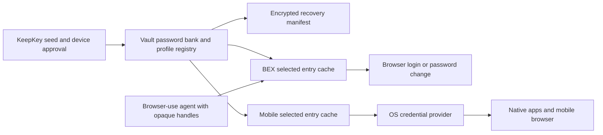
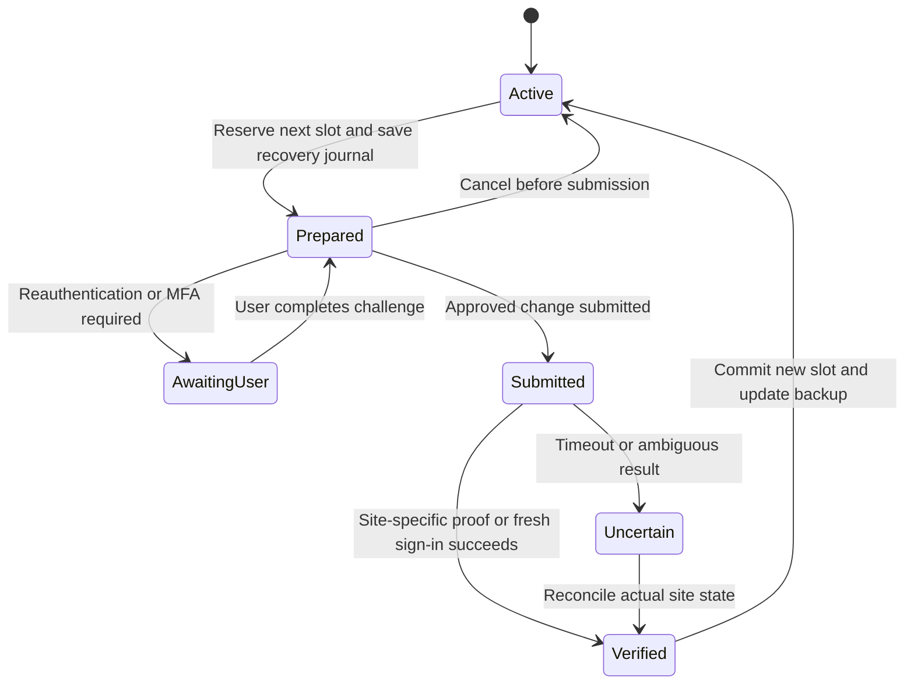

# KeepKey password bank and assisted rotation design

KeepKey generates a bank of reproducible password entries. Vault keeps an encrypted registry of which derivation location belongs to each domain and account. BEX and mobile cache a user-selected subset for everyday use, evict entries on expiry, and ask for rehydration when the device reconnects. BEX also tracks actual website password changes and offers guided, versioned rotation workflows.

This is a proposed architecture. Existing components and confirmed security issues are described in [the audit](README.md).

## Product responsibilities

| Component | Responsibility |
| --- | --- |
| KeepKey | Retain seed and derivation roots; approve bounded bank generation; reproduce specific entries |
| Desktop Vault | Own profile registry, allocation, encrypted recovery backup, device interaction and cache grants |
| BEX | Match trusted browser origins; select account; fill one secret; track and assist website rotation |
| Mobile native layer | Protect selected cache entries; enforce expiry; integrate with OS password autofill |
| Optional relay/sync | Transport authenticated ciphertext; never receive the password bank or recovery root in plaintext |
| Browser-use agent | Navigate and explain workflows using opaque handles and redacted page observations |

“BEX autofill in apps” has two implementation paths: BEX fills browser pages, while the mobile app supplies credentials to other native apps through the OS. iOS uses a [credential-provider extension](https://developer.apple.com/documentation/authenticationservices/ascredentialproviderviewcontroller). Android needs a [Credential Manager provider](https://developer.android.com/identity/sign-in/credential-provider) on supported versions and an Autofill integration where required. These native integrations are not present in the inspected Expo shell.



## Recovery contract

The recovery promise is **same mnemonic, same wallet passphrase, same derivation recipe and same saved locations produce the same generated passwords**. Users never enter the mnemonic into BEX, mobile, a web page or an agent. A replacement KeepKey performs recovery and derivation.

The seed does not reveal which slot was used for which account. The encrypted recovery manifest must preserve bank identity, derivation algorithm/version, slot allocation, encoding and policy, domain and username, active/previous/pending slot, rotation state and revisions. Back it up independently of a single phone or laptop. Its decryption must be recoverable through a replacement device using the same seed/passphrase; a key available only from the lost phone's Keychain is insufficient.

Do not silently scope derivation to a device serial number or an installation-specific random secret. Both prevent replacement-device recovery. A random bank ID or encryption salt is acceptable only when it is retained in the recovery manifest. Identify the wallet using a dedicated domain-separated check, not its public device serial; fail closed across seed/passphrase changes.

Imported existing passwords cannot be regenerated from the seed. Their ciphertext needs its own backed-up contents and recoverable wrapping. TOTP seeds, recovery codes and passkeys likewise need explicit policies; they do not become reproducible merely by sharing the password-manager UI.

## Bank derivation and profiles

Use a small initial bank, for example 32 ready entries, replenished by explicit device approval. Allocation is global within a bank: never assign one generated password to two accounts, and never recycle a retired slot. Keep a backed-up high-water mark and allocation journal so offline devices cannot allocate the same range independently. For multiple allocators, reserve disjoint ranges first.

[BIP85](https://github.com/bitcoin/bips/blob/master/bip-0085.mediawiki#pwd-base64) already defines an interoperable Base64 password application:

```text
m/83696968'/707764'/<password-length>'/<slot-index>'
password = Base64(BIP85 entropy)[0:password-length]
```

Its specified length is 20–86 characters. Use the specification's vectors rather than inventing a password by truncating a wallet signature. The audit probe matches the published 21-character vector in software. Current KeepKey BIP85 code implements the mnemonic application, not this password application.

Base64 does not guarantee every site's required character categories. Maintain explicit formatter versions and policy IDs. A custom policy formatter needs deterministic unbiased sampling, fixed Unicode/encoding behavior, bounded failure and independent vectors; do not label custom output as standard BIP85. Existing profile algorithms remain immutable across app updates. A policy change stages a new slot and an actual account rotation.

Example registry entry; none of these values is a password:

```json
{
  "profileId": "profile-google-personal",
  "bankId": "main",
  "account": "person@example.com",
  "loginOrigins": ["https://accounts.google.com"],
  "settingsOrigins": ["https://myaccount.google.com"],
  "active": {
    "algorithm": "bip85-pwd-base64-v1",
    "length": 24,
    "slot": 137
  },
  "pending": null,
  "rotationRevision": 3,
  "rotationState": "active",
  "cachePolicy": { "ttlHours": 72 },
  "rotationPolicy": { "reviewAfterDays": 90 },
  "lastVerifiedChangeAt": "2026-11-07T12:00:00Z"
}
```

The domain/account mapping labels a standard indexed BIP85 slot; it is not cryptographically part of that standard's derivation. Bind labels to an authenticated registry and show account, slot range and policy on the device during generation/rehydration. If cryptographic domain/account binding is required, specify a distinct reviewed derivation scheme and version it separately. Freeze canonical identifiers; editing a display label must not silently change the password.

## Device and storage boundaries

Add a dedicated password-generation protobuf command. It should enforce PIN/unlock, selected wallet passphrase, range/policy limits, explicit user approval and secret-memory cleanup. A batch approval identifies the bank and count and exposes only that bounded batch. Root keys and bank-wide derivation keys stay on-device. Add cancellation, transport-switch, malformed-input, debug/screen-capture and seed-change tests.

For everyday autofill, an approved entry deliberately leaves the hardware and exists briefly on the host/phone. Device-screen-only display can remain an option, but it cannot supply unattended autofill. A cached password has the security properties of the endpoint holding it; expiry cannot undo a copy already stolen.

The existing `CipherKeyValue` implementation derives a key from a path and label and uses AES-CBC without an authentication tag. Its prompt flags are caller-controlled and also affect derivation. It can inform a compatibility investigation, but it is not by itself a complete vault encryption design. Use authenticated encryption with metadata binding for registry, cache and backup records. Keep metadata-encryption keys separate from password-derivation roots.

A recoverable vault key-wrap mechanism needs its own domain-separated firmware key and versioned authenticated format. A random vault data key may be wrapped for seed-based recovery; phone/browser access additionally wraps authorized cache keys for the local endpoint. Recovering registry metadata must not export a root that can generate the entire password bank. Persist ciphertext and wrapped keys with backup and corruption detection.

## Cache eviction and rehydration

Track these as distinct states: **available**, **expired on this endpoint**, **needs device refill**, and **password change due**. Cache TTL and account rotation schedule are separate settings.

1. User approves selected profiles and duration while KeepKey is connected.
2. Generate/reproduce only those entries. Encrypt each entry independently with an endpoint-protected key; store only ciphertext outside Keychain/Keystore-backed custody.
3. On every read/autofill, foreground transition and unlock, check expiry and wallet/profile revision. Delete expired ciphertext/key references and in-memory copies, and remove expired OS autofill availability. A background timer alone is insufficient because mobile suspends apps.
4. Rehydrate the same active slot when KeepKey reconnects. Do not rotate the website password or advance the slot just because a phone cache expired.
5. After an actual website rotation, invalidate old grants/cached revisions on reachable endpoints. Offline endpoints reconcile before reuse; they may retain a stale copy until then, bounded by their own TTL. A rotation and device-revocation protocol must describe this limit.

Use a biometric/device-authentication gate as appropriate for each endpoint. [Expo SecureStore](https://docs.expo.dev/versions/latest/sdk/securestore/) can protect small local key records, but platform behavior after uninstall or biometric enrollment changes must be handled. Native autofill extensions need compatible key access and their own expiry checks.

Expiry is an application-enforced eviction policy, not guaranteed remote deletion or forensic erasure of flash. Test clock rollback, process termination, device reboot, backups and restore. Never place cached passwords in AsyncStorage, browser sync storage, hosted-page localStorage, logs, analytics or agent transcripts.

## Pairing for secret rehydration

Introduce a separate versioned secret-cache enrollment flow. The existing public-wallet relay must not gain password fields.

Use a reviewed authenticated key exchange that binds the approved phone/extension key, wallet/bank identity and a high-entropy QR invitation. The out-of-band authentication secret must not be uploaded to the relay alongside the ciphertext. A human-readable short code needs a suitable authenticated protocol and strict rate limits, rather than being used directly as an encryption key.

Each cache grant binds endpoint identity, selected profile IDs and revisions, issue/expiry, nonce and protocol version. Require replay rejection, confirmation/acknowledgment, cancellation and endpoint revocation. Relay sees ciphertext. Refill requires the desktop plus connected KeepKey unless a separate direct mobile USB transport is implemented and validated; the current mobile app has no such transport.

## BEX autofill and agent boundary

Reuse BEX's authenticated Vault connection and browser routing. Add password-specific authorization; a generic paired REST key and Agent mode toggle must not automatically grant bank export, password reveal or rotation.

Proposed operations, not existing APIs:

| Operation | Output and restriction |
| --- | --- |
| `password_profiles(origin)` | Account labels/status only, subject to permission; never password values |
| `password_fill(profileId, tabId, frameId, fieldRef, grant)` | Fill the approved credential into a verified field; return status only |
| `rotation_prepare(profileId, recipeId)` | Persist a pending slot and recovery journal; return opaque rotation handle |
| `rotation_fill(handle, fieldRole)` | Fill old/new/confirmation values within the recipe's approved origin/document |
| `rotation_verify(handle)` | Record site-specific verification evidence; return verified or uncertain |
| `rotation_commit(handle)` | Atomically activate verified pending slot, update backup, invalidate stale grants |

Derive the real origin and document identity from browser APIs and message sender metadata. Check them again at fill time, including frame origin, redirects, tab changes, navigation races and form destination. Do not use substring domain checks or treat a page's self-reported origin as authority. Account selection and cross-origin identity-provider flows need explicit mappings. BEX side-panel UI and capability grants bind the selected browser profile, tab, account and action.

Keep secrets out of the page's injected wallet-provider API and generic `window.postMessage` RPC. Content-script isolated worlds protect extension variables, but share the page DOM; [Chrome's documentation](https://developer.chrome.com/docs/extensions/develop/concepts/content-scripts) does not make filled passwords invisible to website scripts.

The browser-use agent should ask to fill an opaque handle and receive a status. Fix the confirmed snapshot/type leaks before introducing this operation. Protected workflows also need value redaction and blocking of alternate read/evaluate/storage/screenshot routes that could recover those secrets; a handle is ineffective if another generic tool can immediately read the field. Page text is workflow input, never authority to widen a grant or exfiltrate a value.

## Website rotation transaction



Before submission, back up the pending slot and retain the current active location. Bind the change to the expected account, site and browser session, and obtain approval for the actual password change. After submission, do not automatically discard the pending entry or retry the change on an ambiguous timeout: the website may already have changed it.

Verification needs stronger evidence than a click, URL change or arbitrary page text. Prefer a known success state plus site/account verification, and a fresh authentication check where practical. If the result is ambiguous, preserve both derivation locations with a visible “verification needed” status. Do not automatically restore the old password; that is another website mutation. Preserve historical slot metadata for recovery even after old cache plaintext is evicted.

Persist a journal with operation ID, expected active revision, old/new locations, stage, recipe version and verification status. Use compare-and-swap on profile revision and an exclusive rotation lease to prevent two devices changing one account concurrently. Restart after each stage must resume or reconcile without allocating or submitting another password.

## Initial recipe library

Ship reviewed, versioned workflows with BEX rather than fetching and executing arbitrary scripts. Each recipe declares exact allowed origins, account checks, password policy, expected form roles, user checkpoints, submission boundary, success evidence, failure/unknown states and tested date/browser versions. Page selectors and language variants need ongoing maintenance.

Start with Google Account, then add GitHub and Microsoft after testing on dedicated accounts. These are proposed targets, not working shipped integrations. For Google, [the supported path](https://support.google.com/accounts/answer/41078) is Google Account → Security and sign-in → Password → change password; reauthentication may be required, and changing the password signs out many sessions. Announce that consequence before the final action.

A Google recipe begins by identifying the exact account, reserving/backing up a compatible new slot, navigating to the approved account security flow, and pausing for reauthentication/MFA. It fills the new/confirmation values through the secret broker, pauses for final approval, submits once, verifies, then commits. CAPTCHA, recovery challenges, unexpected UI and unsupported policies transition to guided/manual completion. Agents assist navigation and diagnosis; they do not invent successful completion or bypass the account's authentication controls.

Track `lastVerifiedChangeAt`, `nextReviewAt`, reason due, pending operation and verification status. User-defined schedules should produce reminders or an explicitly opted-in workflow. Mobile cache expiration must never be displayed as a completed website rotation.

## Acceptance milestones

1. **Recovery:** Generate synthetic profiles on a test device, back up the manifest, remove local app state, restore the same mnemonic/passphrase on another test device and reproduce all active and pending entries exactly.
2. **Isolation:** Wrong seed/passphrase, tampered manifest, changed formatter version and mismatched slot mapping fail without silently replacing an active credential.
3. **Cache:** Expired entries cannot be filled after suspension, clock changes, reboot, provider-extension invocation or backup restore. Refill reproduces the current website password.
4. **BEX:** Password snapshots and typing diagnostics are redacted; no generic agent path returns protected values; wrong origin/frame/document/browser grants and navigation races are rejected.
5. **Rotation:** Exercise acceptance, policy rejection, MFA pause, cancel, lost response, browser crash and concurrent change. No unverified operation advances the active slot, and an ambiguous submitted operation preserves both locations.
6. **Mobile:** Native autofill works only for matched accounts, approved apps/domains, fresh cache entries and the required user authentication. Unpair/revoke/expiry clears the correct local and OS identities.
7. **Passkeys:** Test direct CTAP2 separately. Current passkey state has a different recovery contract; do not infer seed-only recovery from successful password-bank restoration.
